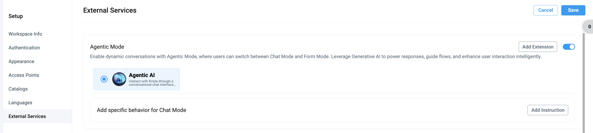
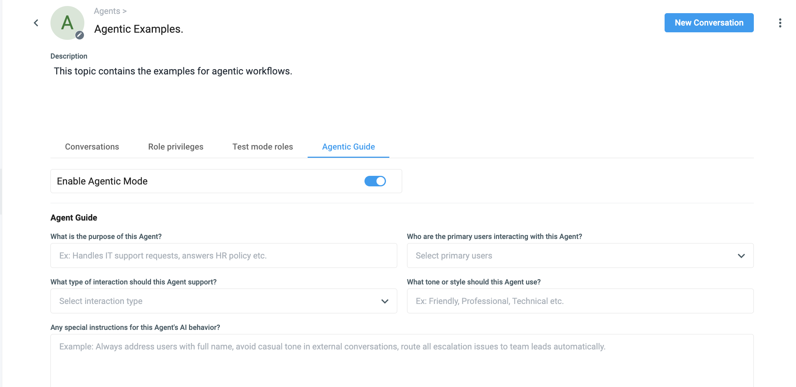
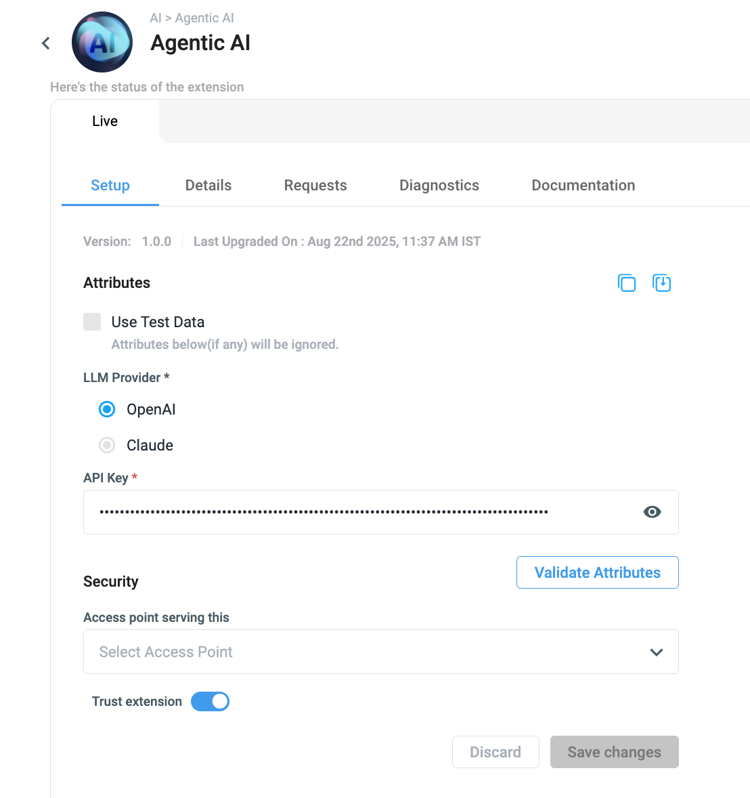

# Setup and configuration

## Setup
1. **Enable Agentic AI at Workspace level** - Navigate to Setup > External Services and add the Agentic AI extension under Agentic mode if not already present, then enable it. (Workspace level instructions are not currently supported and can be skipped)

2. **Enable Agentic AI at Agent level** - Go to Conversations, select the desired agent, click the Agentic Guide tab, and enable Agentic mode. (Agent level instructions are not currently supported and can be skipped)

3. **Configure LLM provider** - Navigate to Extensions > Agentic AI and configure the LLM provider and API key as described in the Extension Settings section below.

## Extension configuration

The Agentic AI Extension provides several configuration options to customize its behavior:

#### LLM Provider
* **Type**: Dropdown
* **Options**: OpenAI, Claude
* **Description**: Cloud LLM provider

#### API Key
* **Type**: Text (Secured)
* **Required**: Yes
* **Description**: API Key for cloud LLM providers (OpenAI or Claude)



### Standard Configuration
```
✓ Cloud LLM Provider: OpenAI (or Claude)
✓ Cloud API Key: sk-your-openai-api-key
```

**Behavior**: System uses the configured cloud LLM provider (OpenAI or Claude) for all requests.
